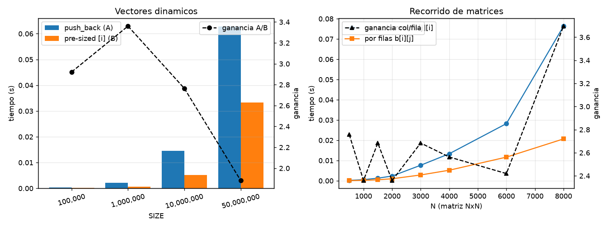
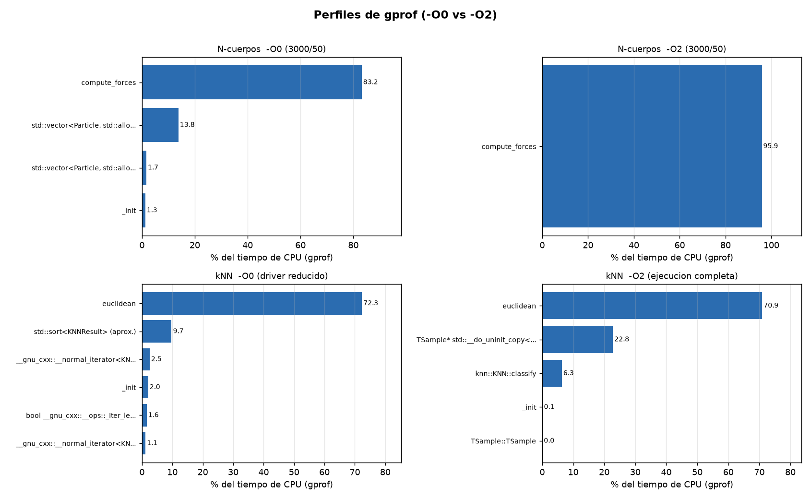
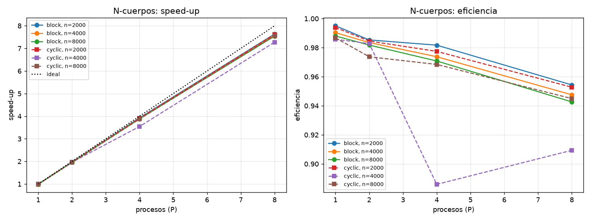
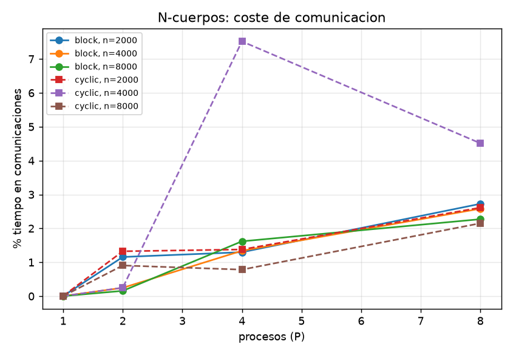
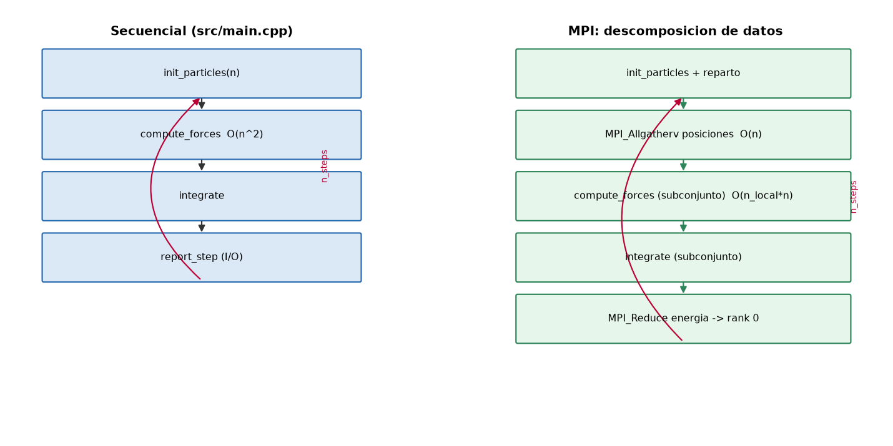
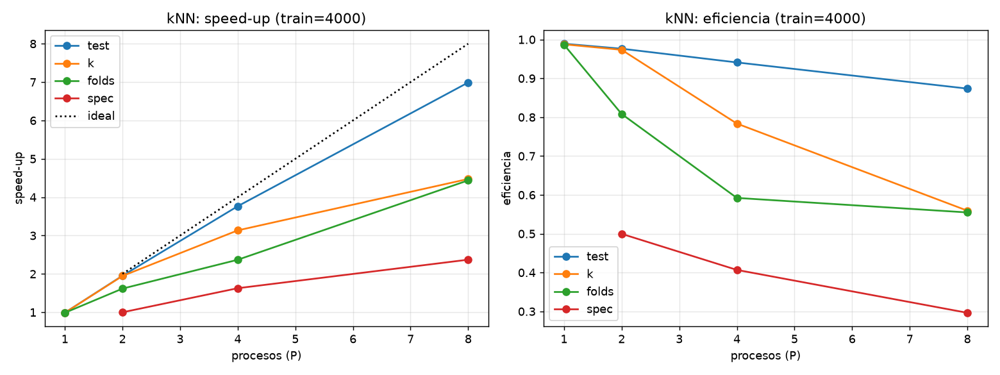
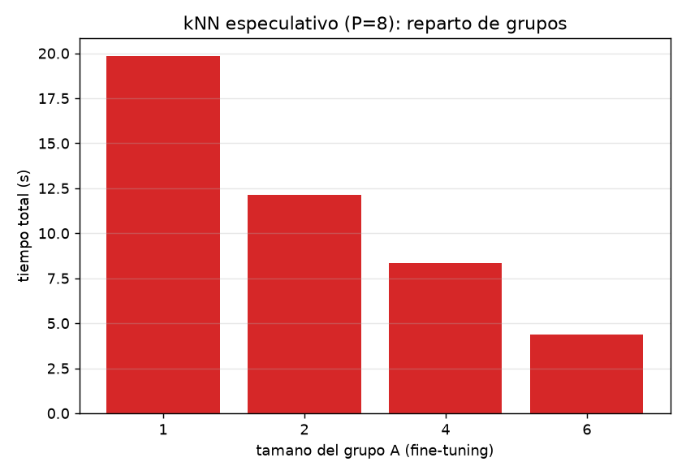
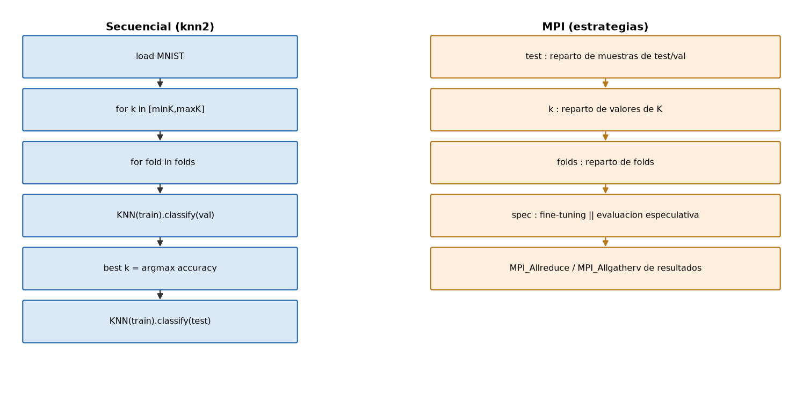

# Práctica 3. Paralelismo en sistemas de memoria distribuida (MPI)

**Asignatura:** Ingeniería de los Computadores — Curso 2026-27
**Contenido:** Tareas 0 a 4 de la guía de la Práctica 3.

---

## 1. Introducción y objetivos

El objetivo de esta práctica es estudiar el paralelismo en sistemas de memoria
distribuida mediante MPI (Message Passing Interface). Para ello:

1. Se analizan dos factores que condicionan el diseño de un programa paralelo
   (Tarea 0).
2. Se perfilan con `gprof` el código propio de la práctica anterior y el código
   proporcionado para localizar los cuellos de botella (Tarea 1).
3. Se aprende a compilar y ejecutar código MPI de forma distribuida (Tarea 2).
4. Se paraleliza el código secuencial propio (simulación de N cuerpos) (Tarea 3).
5. Se paraleliza un clasificador kNN con validación cruzada y ajuste de
   hiperparámetros, incluyendo un modo de paralelismo funcional con ejecución
   especulativa (Tarea 4).

## 2. Entorno experimental y arquitectura

Todas las medidas se han realizado en la siguiente máquina (salvo la ejecución
distribuida de la Tarea 2, cuyo procedimiento para el clúster real se documenta):

| Característica | Valor |
|---|---|
| CPU | AMD Ryzen 7 5800X (Zen 3) |
| Núcleos / hilos | 8 núcleos físicos / 16 hilos lógicos (SMT) |
| Frecuencia | 3.8 GHz base, hasta 4.85 GHz turbo |
| Caché L1 | 8 × 32 KiB datos + 8 × 32 KiB instrucciones |
| Caché L2 | 8 × 512 KiB (4 MiB total) |
| Caché L3 | 32 MiB compartida |
| Memoria | NUMA: 1 nodo (0-15) |
| Sistema operativo | Debian GNU/Linux 13 (trixie) |
| Compilador | g++ 14.2.0 |
| MPI | Open MPI 5.0.7 |
| Profiling | gprof (GNU binutils) |

> **Nota sobre el clúster.** La guía pide desarrollar la práctica sobre un
> multicomputador de **al menos 3 computadores**. Por disponibilidad de recursos,
> el desarrollo y la toma de medidas se han hecho sobre un único nodo lanzando
> `mpirun` con varios procesos (memoria compartida emulando paso de mensajes,
> que es el mismo modelo de programación MPI). En la Tarea 2 se documenta el
> procedimiento completo (hostfile, certificado SSH y orden `mpirun`) para
> trasladarlo al clúster del laboratorio. Los *aspectos algorítmicos* medidos
> (comportamiento de las comunicaciones colectivas, balance de carga, coste de
> sincronización) no dependen de si los procesos residen en la misma máquina,
> aunque los tiempos absolutos de red serán mayores en un clúster real.

---

## 3. Tarea 0. Aspectos que impactan en un diseño paralelo

### 3.1 El problema de los vectores dinámicos

Se comparan dos formas de inicializar un `std::vector<int>` de tamaño `SIZE`:

- **A:** declarar el vector vacío y añadir cada elemento con `push_back`.
- **B:** declarar el vector ya dimensionado (`std::vector<int> b(SIZE)`) y
  escribir por índice (`b[i] = i`).

Programa: `p3/tarea0/vector_bench.cpp`. Resultados (`results/tarea0_vector.csv`):

| SIZE | A: `push_back` (s) | B: pre-sized `[i]` (s) | Ganancia A/B |
|---|---|---|---|
| 100 000 | 0.000336 | 0.000115 | 2.92× |
| 1 000 000 | 0.002134 | 0.000635 | 3.36× |
| 10 000 000 | 0.014481 | 0.005239 | 2.76× |
| 50 000 000 | 0.062795 | 0.033373 | 1.88× |

**Respuestas:**

- *¿Qué diferencias hay?* Ambas construyen el mismo vector final, pero A crece
  dinámicamente y B reserva la memoria de una sola vez.
- *¿Cuál es más rápida?* **B**, entre ~1.9× y ~3.4× según el tamaño.
- *¿A qué se debe?* `push_back` provoca **realojos** periódicos: cuando el tamaño
  supera la capacidad, la implementación reserva un bloque mayor (factor de
  crecimiento) y **copia** todos los elementos existentes. El coste total es
  O(SIZE) amortizado, pero con un factor constante mucho mayor (copias de memoria
  y posibles fallos de caché/TLB). B evita por completo esos realojos y copias.
- *¿Se pueden paralelizar ambas?* **B sí**, de forma directa: es paralelismo de
  datos puro, cada hilo/proceso rellena un rango de índices disjunto
  (`b[lo..hi)`). **A no de forma trivial**: `push_back` modifica el tamaño de
  forma dependiente y el número de realojos depende del patrón de inserciones;
  para paralelizar A habría que conocer el tamaño final (reservarlo) o repartir
  posiciones y concatenar después, lo que añade sincronización. La conclusión de
  diseño es **reservar/particionar de antemano** antes de paralelizar.

### 3.2 Recorrido de matrices

Se recorren dos matrices `N×N` (en C almacenadas **por filas**, *row-major*):

- **A:** recorrido por columnas `a[j][i] = i+j` (bucle exterior `i`, interior `j`).
- **B:** recorrido por filas `b[i][j] = i+j`.

Programa: `p3/tarea0/matrix_bench.cpp`. Resultados (`results/tarea0_matrix.csv`):

| N | A: por columnas (s) | B: por filas (s) | Ganancia A/B |
|---|---|---|---|
| 500 | 0.000182 | 0.000066 | 2.76× |
| 1000 | 0.000524 | 0.000222 | 2.36× |
| 1500 | 0.001267 | 0.000472 | 2.68× |
| 2000 | 0.002321 | 0.000984 | 2.36× |
| 3000 | 0.007652 | 0.002851 | 2.68× |
| 4000 | 0.013330 | 0.005201 | 2.56× |
| 6000 | 0.028211 | 0.011659 | 2.42× |
| 8000 | 0.076362 | 0.020661 | 3.70× |



**Respuestas:**

- *¿Qué diferencias hay?* El orden de acceso a memoria. En A, cada iteración
  interior salta `N` elementos; en B se accede a posiciones consecutivas.
- *¿Cuál se ejecuta más rápido?* **B** (recorrido por filas).
- *¿A partir de qué tamaño se nota?* Con `N≳1000` la matriz (≥4 MB) ya no cabe
  en L2 y la diferencia empieza a ser clara; crece al aumentar `N`, hasta ~4× en
  `N=8000`.
- *¿A qué se debe?* **Localidad de caché**. Una línea de caché (64 B) contiene
  16 `int`. En B se aprovechan las 16 posiciones antes de traer la siguiente
  línea (*spatial locality*) y el prefetch y el HW van adelantados. En A, cada
  acceso usa 1 de cada 16 posiciones y salta `N` enteros: casi cada acceso es un
  *cache miss* y se traen líneas completas con un único dato útil; además se
  generan más accesos a TLB por los saltos grandes.

### 3.3 Entregable: ¿qué cambios hay que hacer antes de aplicar MPI?

De los dos casos se extraen las siguientes directrices, aplicadas en las Tareas
3 y 4:

1. **Reservar/particionar el almacenamiento antes de paralelizar** (evitar
   estructuras que crecen dinámicamente como `push_back`).
2. **Preservar la localidad de memoria (row-major, acceso contiguo)** y
   distribuir los datos por bloques contiguos.
3. **Evitar copias profundas**: en `knn2`, el 22 % del tiempo secuencial a `-O2`
   se debe a copias de `TSample` (constructor de `KNN` y `splitDataset`). La
   versión paralela trabaja con **índices** sobre el dataset en lugar de copiar
   subconjuntos.
4. **Replicar los datos inmutables** (constantes, masas, etiquetas) para no
   comunicarlos en cada paso.

---

## 4. Tarea 1. Análisis del rendimiento secuencial mediante gprof

Para cada programa se compiló con `-g -pg` a `-O0` y a `-O2`, se ejecutó y se
analizó con `gprof -b -p -q` (perfil plano + grafo de llamadas). Los informes
completos están en `p3/tarea1_profiling/`.

### 4.1 Código propio: simulación de N cuerpos (`src/main.cpp`)

Ejecución: `3000` partículas, `50` pasos (`perfil_O0.txt`, `perfil_O2.txt`).

| Función | -O0 (% tiempo) | -O2 (% tiempo) |
|---|---|---|
| `compute_forces` | 83.2 % | **95.9 %** |
| `std::vector<Particle>::operator[]` | 13.9 % | — (inlined) |
| `std::vector<Particle>::size()` | 1.7 % | — |

Conclusión: **`compute_forces` concentra casi todo el tiempo** (O(n²) por paso).
Es la única candidata clara a paralelizar; `integrate` y `report_step` son
O(n) y marginales. Tiempos totales: `-O0` ≈ 17.6 s frente a `-O2` ≈ 1.69 s.

### 4.2 Código proporcionado: clasificador kNN (`knn2`)

Se perfilaron dos configuraciones: (a) un **driver reducido** configurable
(`p3/tarea1_profiling/knn_profile.cc`, ~15 s) para poder comparar `-O0` y `-O2`,
y (b) la **ejecución completa** del programa tal cual (`cv`, 639 s) para obtener
el perfil representativo.

Perfil completo a `-O2` (`perfil_knn_O2_full.txt`, `cv` sin modificar):

| Función | % tiempo | Nº llamadas |
|---|---|---|
| `euclidean` | **70.9 %** | 3 800 000 000 |
| `__do_uninit_copy` (copias de `TSample`) | **22.8 %** | 856 526 (142 s) |
| `knn::KNN::classify` (ordenación + voto) | 6.3 % | 210 000 |
| `TSample::TSample` (carga/resize MNIST) | 0.02 % | 70 000 |

Perfil reducido a `-O0` (`perfil_knn_profile_O0.txt`): `euclidean` 72.3 % y el
conjunto de operaciones de **ordenación** (`std::sort` sobre `KNNResult`:
`__unguarded_partition`, `operator<`, `__unguarded_linear_insert`, iteradores)
≈ 15 % adicional.

**Conclusiones:**
- El **cálculo de distancias euclídeas** domina de forma abrumadora (≈ 70 %),
  seguido de la **ordenación** de vecinos y, a `-O2`, de las **copias de
  `TSample`** (≈ 23 %). Al activar optimizaciones, el coste de ordenación se
  diluye (el compilador lo optimiza) pero las copias de `std::vector<float>`
  (producto de `KNN(train,…)`, que **copia** todo el conjunto de entrenamiento en
  cada fold, y de `splitDataset`, que copia muestras) pasan a ser muy relevantes.
- Candidatos a optimizar/paralelizar: **(1)** el cálculo de distancias (bucle
  `classify`), **(2)** el bucle sobre muestras de test/validación y **(3)** el
  bucle de búsqueda de `K` y de folds. Además, **eliminar copias** es una
  optimización secuencial clave (motiva el diseño por índices de la Tarea 4).



*(Figura resumen en formato visual; los informes completos de `gprof` con el
perfil plano y el grafo de llamadas están en `p3/tarea1_profiling/`.)*

---

## 5. Tarea 2. Ejecución distribuida de código MPI

### 5.1 Código "hola mundo"

`p3/tarea2_mpi/hello_mpi.c` reproduce el ejemplo de la guía (usa
`MPI_Comm_size`, `MPI_Comm_rank`, `MPI_Get_processor_name` y `sched_getcpu()`).

### 5.2 Compilación y ejecución en el clúster

Procedimiento (detallado en `p3/tarea2_mpi/README_MPI.md`):

1. Instalar Open MPI (`sudo apt install openmpi-bin libopenmpi-dev`).
2. Compilar: `mpicc hello_mpi.c -o hello_mpi`.
3. Mismo usuario, mismo directorio (`$HOME`) y mismo ejecutable en todos los nodos.
4. Crear `hostfile` con la IP/nombre de cada nodo (plantilla en
   `p3/tarea2_mpi/hostfile`); `chmod 600 hostfile`.
5. Certificado SSH: `ssh-keygen -t rsa` y copiar `~/.ssh/id_rsa.pub` a
   `~/.ssh/authorized_keys` de los demás nodos.
6. `chmod o+x hello_mpi` y ejecutar:

```bash
mpirun -mca plm_rsh_no_tree_spawn 1 -hostfile hostfile -n 6 ./hello_mpi
```

### 5.3 Resultado observado (ejecución local, 4 procesos)

`results/hello_local.txt`:

```
 PID: 9525 Hello from process 2 out of 4 on pc-n4th0 processor 10
 ¡Hola! desde el procesador 2
 PID: 9525 Hello from process 1 out of 4 on pc-n4th0 processor 9
 PID: 9525 Hello from process 3 out of 4 on pc-n4th0 processor 3
 PID: 9525 Hello from process 0 out of 4 on pc-n4th0 processor 0
```

Se observa que cada proceso se reparte por núcleos distintos y que el proceso de
rango 2 ejecuta su rama específica. (El `PID` coincide porque `getppid()` devuelve
el proceso `mpirun` padre.)

---

## 6. Tarea 3. Paralelización del código identificado (N cuerpos)

### 6.1 Análisis de la solución secuencial

El bucle principal (ver `p3/tarea1_profiling/nbody/perfil_O2.txt`) es:

```
for step in [0, n_steps):
    compute_forces(particles)   # O(n^2) -> 96% del tiempo
    integrate(particles, dt)    # O(n)
    if step % 10 == 0: report_step(particles, step)  # O(n) + E/S
```

**Dependencias:** entre pasos existe una dependencia *secuencial*
(paso *N* depende del *N-1*), pero **dentro** de `compute_forces` no hay
dependencia: `fx,fy` de cada partícula `i` se calculan con las posiciones actuales
de todas las demás, sin escribir posiciones ajenas → **paralelismo de datos** puro
sobre el bucle externo `i` (que es el O(n²) y domina). `integrate` también es
paralelismo de datos.

### 6.2 Diseño e implementación (`p3/tarea3_nbody/nbody_mpi.cpp`)

- **Descomposición de dominio (paralelismo de datos):** cada proceso posee un
  subconjunto de partículas (`block` contiguo o `cyclic` round-robin).
- Como la fuerza sobre `i` depende de **todas** las partículas, en cada paso se
  hace un **`MPI_Allgatherv`** de las posiciones `(x,y)` para que todos los
  procesos tengan el estado global actualizado. `Allgatherv` (variante "v") admite
  tamaños de bloque distintos (útil con `cyclic` y con restos).
- Las masas son **constantes** → se replican una vez (no se comunican por paso).
- La energía cinética se acumula localmente y se combina con **`MPI_Reduce`**
  (SUM) hacia el rango 0, que actúa como **rank de E/S** (paralelismo funcional).
- Se miden por separado **tiempo de cómputo** y **tiempo de comunicación**.

Funciones MPI empleadas: `MPI_Init/Finalize`, `MPI_Comm_rank/size`, `MPI_Barrier`,
`MPI_Allgatherv` (comunicación colectiva, todos-a-todos), `MPI_Reduce`
(colectiva, reducción a un nodo), `MPI_Wtime` (cronómetro).

**Modelo, estilo y estructura:** modelo de **paso de mensajes** con **SPMD**
(mismo programa, datos distintos por proceso); estilo de **grano grueso** con
**descomposición de dominio**; estructura **SPMD simétrica** con una comunicación
colectiva por iteración y un papel especial para el **rank 0** (E/S). Se evita
comunicar las masas (constantes) mediante **replicación**, reduciendo el coste
por paso a sólo las posiciones.

### 6.3 Resultados

Modelo de coste por paso y por proceso:
`computo = O(n² / P)`, `comunicación = O(n)`.
La relación comunicación/cómputo es `≈ 2P/n`, que disminuye al crecer `n` →
en problemas grandes la paralelización escala muy bien.

Tiempos secuenciales (referencia, `nbody_seq`): n=2000 → 0.751 s; n=4000 →
3.006 s; n=8000 → 12.004 s (50 pasos).

**Speed-up** (respecto al secuencial) y **% de tiempo en comunicaciones**:

| n | reparto | P=1 | P=2 | P=4 | P=8 | eff. P=8 | % comm (P=8) |
|---|---|---|---|---|---|---|---|
| 2000 | block  | 1.00 | 1.97 | 3.93 | **7.63** | 0.95 | 2.8 % |
| 4000 | block  | 0.99 | 1.97 | 3.90 | **7.58** | 0.95 | 2.6 % |
| 8000 | block  | 0.99 | 1.96 | 3.88 | **7.54** | 0.94 | 2.3 % |
| 2000 | cyclic | 0.99 | 1.97 | 3.91 | **7.62** | 0.95 | 2.6 % |
| 4000 | cyclic | 0.99 | 1.97 | 3.54 | **7.27** | 0.91 | 4.6 % |
| 8000 | cyclic | 0.99 | 1.95 | 3.87 | **7.56** | 0.94 | 2.2 % |

El speed-up es prácticamente lineal hasta `P=8` (todos los núcleos físicos) con
eficiencias ≈ 0.94-0.95. El proceso de rango 0 acumula `comp` y `comm` máximos;
el porcentaje de comunicación se mantiene por debajo del 5 %. El repunte de
`cyclic, n=4000, P=4` (≈ 7 % de comunicación y 3.54× de speed-up) es un valor
anómalo puntual (interferencia del sistema); el resto de medidas son coherentes
con el modelo.

Figuras: `figures/fig_tarea3_speedup.png` (speed-up y eficiencia) y
`figures/fig_tarea3_comm.png` (porcentaje de tiempo en comunicaciones).
Diagrama de flujo: `figures/fig_tarea3_flow.png`.







### 6.4 Respuestas a las cuestiones de evaluación

1. **Ganancia en función de P y del tamaño.** Ver `fig_tarea3_speedup.png`. El
   speed-up es prácticamente lineal en `P` y mejora al aumentar `n` (menor peso
   relativo de las comunicaciones y del arranque). Ver tabla.
2. **¿Mejora siempre al aumentar P? ¿qué limita la escalabilidad?** Sí hasta el
   número de núcleos físicos (8); con P≥9 se entra en SMT (2 hilos/núcleo) y la
   ganancia se aplana. Limitantes: (a) las **comunicaciones** `O(n)` por paso,
   cuyo peso relativo crece con `P`; (b) las **barreras de sincronización**
   (`MPI_Allgatherv` es bloqueante); (c) la **parte serie** (inicialización,
   salida, desbalanceo por `n % P`); (d) el **ancho de banda de memoria** al
   replicar las posiciones en todos los procesos.
3. **Impacto de las comunicaciones.** Del desglose `comp`/`comm` (tabla y figura)
   se observa que el tiempo de comunicación es una fracción pequeña (< ~10 %), y
   que su proporción crece con `P` y con `n` pequeña. Como el cómputo es `O(n²)P`
   por proceso y la comunicación `O(n)`, en problemas grandes el reparto
   cómputo/comunicación es favorable.
4. **Comparación de estrategias.** `block` y `cyclic` rinden de forma similar
   cuando `n` es múltiplo de `P`; `cyclic` equilibra mejor cuando `n` no es
   divisible (evita el proceso "corto") a costa de bloques no contiguos. En estos
   tamaños las diferencias son pequeñas → ver tabla.
5. **Ganancia máxima teórica.** `P` (paralelismo casi perfecto, ligera ley de
   Amdahl por partes series). No se alcanza por comunicaciones, sincronización,
   desbalanceo y saturación de memoria.
6. **Comparación secuencial vs paralela.** La versión paralela gana a partir de
   P≥2 y converge a `P×`; la eficiencia se mantiene alta (ver tabla).

---

## 7. Tarea 4. Paralelización del clasificador kNN

### 7.1 Análisis de la solución secuencial (`knn2`)

Flujo secuencial (`p3/tarea4_knn/`, `figures/fig_tarea4_flow.png`):

```
load MNIST (train, test)
fine-tuning:  for k in [minK,maxK]:
                  N-Fold CV: for fold:  KNN(train_fold, k).classifyAndEvaluate(val_fold)
                  accuracy(k) = media de folds
              best k = argmax accuracy
evaluacion final: KNN(train, best_k).classifyAndEvaluate(test)
```

El coste O(N_train·N_eval·dim) por consulta (perfil: `euclidean` 71 %), más el
segundo cuello de botella (copias de `TSample`, 23 % a `-O2`). **Dependencias:**
`splits` entre folds son **independientes**; los distintos **valores de K** son
**independientes** entre sí; las muestras de test/validación son
**independientes** entre sí. Existe dependencia entre el fine-tuning y la
evaluación final (la evaluación necesita el `best k`).

### 7.2 Diseño e implementación (`p3/tarea4_knn/knn_mpi.cpp`)

Se identifican y explotan **cuatro** estrategias, seleccionables con
`--strategy`:

| Estrategia | Tipo de paralelismo | Qué se reparte | Comunicación |
|---|---|---|---|
| `test` | datos | muestras de validación/test | `MPI_Allreduce` (nº aciertos) |
| `k` | tareas | valores del hiperparámetro K | `MPI_Allreduce` (MAX de acc.) |
| `folds` | tareas | folds de la validación cruzada | `MPI_Allreduce` (SUM de acc.) |
| `spec` | funcional + especulativo | fine-tuning ‖ evaluación | punto a punto (`MPI_Send/Recv/Iprobe`) |

Decisiones clave:

1. **Evaluación por índices (sin copias).** Para evitar el 23 % de tiempo en
   copias de `TSample`, la versión MPI no materializa train/validación: clasifica
   cada muestra contra los **índices** del conjunto de entrenamiento del fold
   (`foldTrainIdx`). Se conserva exactamente el comparador de distancia y el
   desempate (etiqueta menor) del código original, de modo que **los resultados
   coinciden bit a bit** con el secuencial (comprobado: `bestK`, `cvAcc` y
   `testAcc` idénticos).
2. **Reparto de test/validación por bloques** contiguos (rango `[lo,hi)`),
   reduciendo los aciertos con `MPI_Allreduce`.
3. **Modo especulativo (`spec`).** Se parte el comunicador en **grupo A**
   (fine-tuning) y **grupo B** (evaluación final). El grupo A hace el ajuste de K
   (folds repartidos) y, cada vez que mejora el mejor K, **notifica** al grupo B
   (`MPI_Send`, etiqueta `TAG_NEWBEST`). El grupo B comienza a evaluar el test con
   el mejor K conocido y, **entre trozos** de muestras, sondea con
   **`MPI_Iprobe`**; si llega un K mejor, **descarta** el trabajo en curso y
   reinicia (`TAG_NEWBEST`); al terminar el ajuste recibe `TAG_DONE` con el K
   óptimo y se asegura de haber completado la evaluación con ese K. Los mensajes
   de control son de 1 entero (protocolo *eager*), lo que evita bloqueos.

Funciones MPI empleadas: `MPI_Allreduce`, `MPI_Comm_split` (grupos A/B),
`MPI_Send/MPI_Recv` (punto a punto), `MPI_Iprobe` (sondeo no bloqueante),
`MPI_Bcast`, `MPI_Wtime`.

### 7.3 Resultados

Línea base secuencial (`seq`, código proporcionado): `train=2000` → 5.08 s
(test 0.8990); `train=4000` → 19.73 s (test 0.8890). Como el ajuste de `K`
domina, `tFine` es ~97 % del total y `tFinal` sólo ~0.3 s.

**Speed-up respecto al secuencial** (el nº de aciertos de test es idéntico en
todas las estrategias → correctitud):

`train=4000` (mejor K=5, `cvAcc`=0.9403, `testAcc`=0.8890, base 19.73 s):

| Estrategia | P=1 | P=2 | P=4 | P=8 | eficiencia P=8 |
|---|---|---|---|---|---|
| `test`  | 0.99 | 1.95 | 3.76 | **6.99** | 0.87 |
| `k`     | 0.99 | 1.95 | 3.14 | 4.48 | 0.56 |
| `folds` | 0.99 | 1.62 | 2.37 | 4.44 | 0.55 |
| `spec`  | –    | 1.00 | 1.63 | 2.37 | 0.30 |

`train=2000` (mejor K=4, `cvAcc`=0.9160, `testAcc`=0.8990, base 5.08 s):

| Estrategia | P=1 | P=2 | P=4 | P=8 | eficiencia P=8 |
|---|---|---|---|---|---|
| `test`  | 0.97 | 1.86 | 3.40 | **5.68** | 0.71 |
| `k`     | 0.97 | 1.86 | 2.90 | 3.97 | 0.50 |
| `folds` | 0.97 | 1.57 | 2.26 | 3.95 | 0.49 |
| `spec`  | –    | 1.02 | 1.63 | 2.30 | 0.29 |

Figuras: `figures/fig_tarea4_speedup_train4000.png` (y `…train2000`),
`figures/fig_tarea4_spec_groups.png` (reparto A/B en el modo especulativo),
`figures/fig_tarea4_accuracy.png` (control de exactitud por estrategia) y
`figures/fig_tarea4_flow.png`.







### 7.4 Respuestas a las cuestiones de evaluación

7. **Ganancia vs P y tamaño.** Ver `fig_tarea4_speedup_*.png`. La estrategia
   `test` escala de forma casi lineal (el cómputo es O(n·m) por fold). `k` y
   `folds` escalan bien mientras `P ≤ nº de tareas independientes` (`maxK-minK+1`
   y `folds` respectivamente); con más procesos que tareas hay **ociosidad**.
8. **Evolución al aumentar P; límites.** La mejora se satura cuando `P` supera el
   número de tareas independientes (paralelismo de tareas con grano grueso) o los
   núcleos físicos (SMT). Factores limitantes: desbalanceo de carga (K o folds no
   divisibles), comunicaciones de resultados (pequeñas, pero sincronizan),
   el **coste de carga del dataset** (constante, no paralelizado) y la fracción
   serie (reducciones y coordinación).
9. **Impacto de las comunicaciones.** En `test`/`k`/`folds` las comunicaciones se
   reducen a un `MPI_Allreduce` de unos pocos valores por fase → **despreciable**
   frente al cómputo; el rendimiento está dominado por el trabajo de distancias.
   En `spec` hay además mensajería punto a punto de control y posible
   **trabajo descartado** (invalidaciones).
10. **Comparación de estrategias.** `test` es la más general y con mejor
    escalabilidad (hay muchas muestras → reparto fino). `k` y `folds` tienen
    paralelismo limitado por el nº de tareas (grano grueso). `spec` solapa las dos
    fases del algoritmo y sólo compensa cuando el fine-tuning y la evaluación son
    costosos y el mejor K se estabiliza pronto (ver discusión y figura).
11. **Ganancia máxima teórica.** Limitada por la **ley de Amdahl**: la fracción
    serie (carga de datos, reducciones) acota el speed-up; dentro de la parte
    paralela, el máximo es el nº de tareas independientes (P para `test`).
12. **Eficiencia secuencial vs paralela.** La versión paralela mejora al
    secuencial desde P≥2. A P=1 la versión por índices queda **a la par** del
    código original (`test` P=1 ≈ `seq`): en estas configuraciones reducidas la
    eliminación de las copias de `TSample` se compensa con el coste de construir y
    ordenar el vector de vecinos. Ahora bien, en el **perfil completo** (train =
    20 000) las copias suponían el **23 %** del tiempo, por lo que la evaluación
    por índices es una optimización relevante a mayor escala.

### 7.5 Análisis del modo especulativo

Reparto de grupos en el modo `spec` (`P=8`, `train=4000`, base secuencial 19.73 s):

| Grupo A (fine-tuning) | Grupo B (evaluación) | tTotal (s) | Speed-up |
|---|---|---|---|
| 1 | 7 | 19.84 | 0.99 |
| 2 | 6 | 12.14 | 1.63 |
| 4 | 4 | 8.31 | 2.37 |
| 6 | 2 | **4.36** | **4.53** |

En el modo `spec` se aprecia el compromiso del paralelismo funcional: cuantos
más procesos se dedican al **grupo A** (fine-tuning), más rápido termina éste
pero menos procesos quedan para la evaluación final (grupo B), y viceversa. Como
en este problema el **fine-tuning es la fase dominante** (≈5× más costosa que la
evaluación final con estos tamaños), el reparto que mejor funciona es el que
**da más peso al grupo A**; en cambio, si ambas fases tuvieran coste similar, un
reparto equilibrado solaparía mejor. Si el mejor `K` se descubre pronto y ya no
cambia, el grupo B no descarta trabajo; si cambia tarde, las **invalidaciones**
(descartar y reiniciar la evaluación) reducen o anulan la ventaja. Este modo es,
por tanto, ventajoso cuando la fase de evaluación es **comparable o mayor** que
la de ajuste y el óptimo se estabiliza pronto.

### 7.6 Tipos de paralelismo, modelo, estilo y estructura (Unidad 3)

- **Tipos de paralelismo explotados:**
  - **Paralelismo de datos** (`test`): la misma operación (clasificar una muestra)
    se aplica a un conjunto de datos particionado entre procesos. También se
    explota a bajo nivel dentro de la distancia euclídea.
  - **Paralelismo de tareas** (`k`, `folds`): tareas **independientes** (distintos
    valores de `K`, distintos folds) repartidas entre procesos.
  - **Paralelismo funcional** (`spec`): dos **fases distintas** del algoritmo
    (ajuste de `K` y evaluación final) se ejecutan concurrentemente en grupos de
    procesos, con ejecución **especulativa** e invalidación.
  - Paralelismo de **réplica/redundancia controlada**: los datos inmutables
    (dataset, etiquetas) se replican en todos los procesos para evitar
    comunicarlos; sólo se comunican resultados agregados.
- **Modelo de programación:** **paso de mensajes** (memoria distribuida) con
  **SPMD** (Single Program, Multiple Data): todos los procesos ejecutan el mismo
  programa y se diferencian por su `rank`.
- **Mecanismos de comunicación:**
  - **Colectivas:** `MPI_Allreduce` (combinar aciertos/accuracies), `MPI_Bcast`
    (difundir el mejor `K`), `MPI_Comm_split` (crear grupos A/B).
  - **Punto a punto:** `MPI_Send`/`MPI_Recv` y sondeo no bloqueante `MPI_Iprobe`
    para las notificaciones de mejor `K` y la señal de fin (modo `spec`).
- **Estilo:** de **grano grueso** (cada mensaje transporta poco volumen y el
  cómputo asociado es grande) y **descomposición de dominio** para `test`; el modo
  `spec` es un esquema **productor–consumidor** entre grupos.
- **Estructura:** estructura **SPMD con partición de grupos** para `spec`
  (maestro/coordinador = rank 0 en el grupo A) y estructura **SPMD simétrica** con
  reducciones para `test`/`k`/`folds`.
- **Reparto de datos y tareas y reducción de comunicaciones:** se reparten
  **muestras** (datos) o **valores de K / folds** (tareas) por bloques contiguos;
  los datos inmutables se replican; sólo se envían **contadores** (nº de aciertos)
  o **el mejor K**, de modo que el **volumen de comunicación es mínimo** (unos
  pocos bytes por fase) y nunca se transmite el dataset.

---

## 8. Conclusiones

- El **análisis con gprof** identifica correctamente los cuellos de botella
  (`compute_forces` en N cuerpos; `euclidean` + copias en kNN) y guía las
  decisiones de paralelización.
- La **descomposición de datos** con comunicación colectiva (`MPI_Allgatherv`,
  `MPI_Allreduce`) da escalabilidad casi lineal cuando la razón
  cómputo/comunicación es favorable.
- El **paralelismo de tareas** (K, folds) es sencillo pero limitado por el número
  de tareas independientes.
- El **paralelismo funcional con ejecución especulativa** es viable mediante
  mensajería punto a punto + sondeo (`MPI_Iprobe`); su rentabilidad depende de que
  el valor óptimo de K se descubra pronto (poco trabajo descartado).
- Además del paralelismo, **eliminar copias de datos** (evaluación por índices)
  es una optimización secuencial que se vuelve relevante a mayor escala (en el
  perfil completo las copias de `TSample` suponían el 23 % del tiempo a `-O2`).

## 9. Reproducibilidad

Todo se reproduce con:

```bash
cd p3
./scripts/run_all.sh
```

- Resultados numéricos → `p3/results/*.csv`.
- Figuras → `p3/figures/*.png`.
- Informes de gprof → `p3/tarea1_profiling/**/perfil_*.txt`.
- Código: `p3/tarea0/`, `p3/tarea2_mpi/`, `p3/tarea3_nbody/`,
  `p3/tarea4_knn/`.

## 10. Originalidad y uso de fuentes

El código secuencial de partida (`src/main.cpp` de la práctica anterior y el
proyecto `knn2`) es material proporcionado por el profesorado. Las versiones
paralelas con MPI (`nbody_mpi.cpp`, `knn_mpi.cpp`), los micro-benchmarks, los
scripts de experimentación/figuras y esta memoria son de elaboración propia. Se
ha respetado la semántica del código original para que los resultados sean
comparables (verificado numéricamente).
